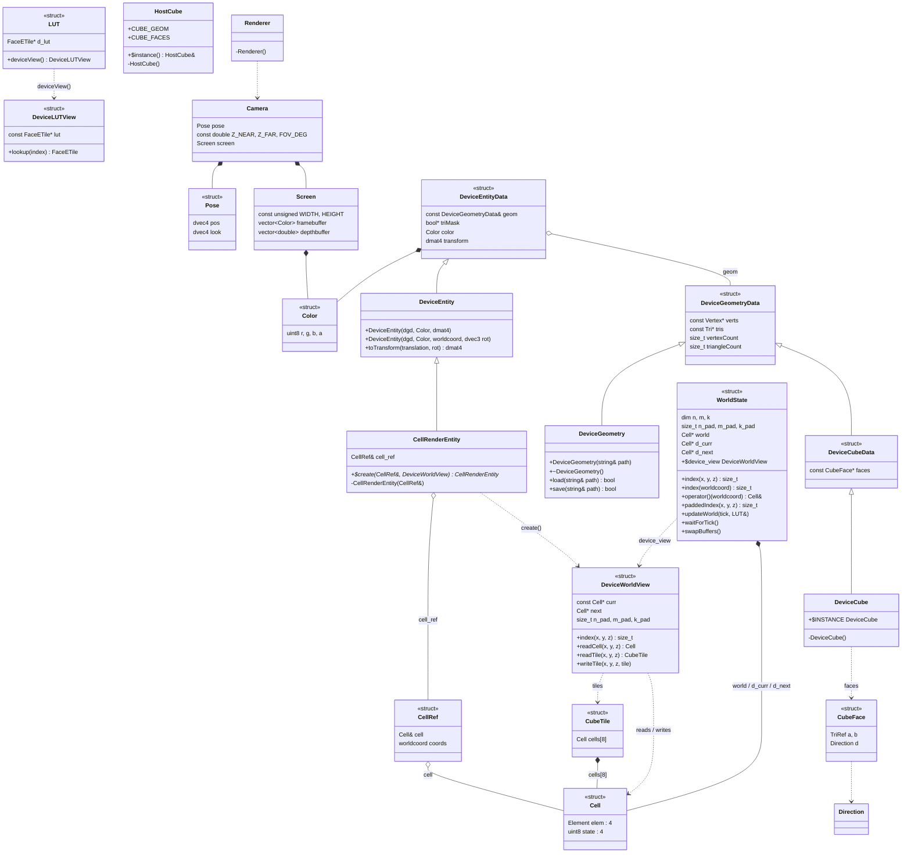

# MEEP class diagram

## Notes

- `HostCube` refers to `Geometry`, which is commented out in `render/primitives.cpp`, so it won't compile until that is resolved.
- `Renderer` is an empty stub; its `Camera` dependency is intended, not yet implemented.
- Edges are approximate: `DeviceEntityData` holds `geom` by reference (aggregation), `Color` by value (composition).
